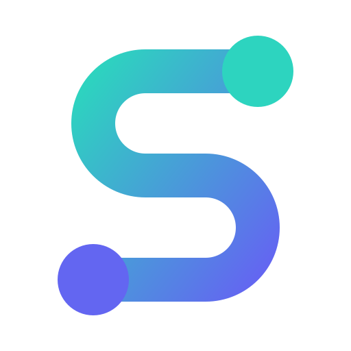
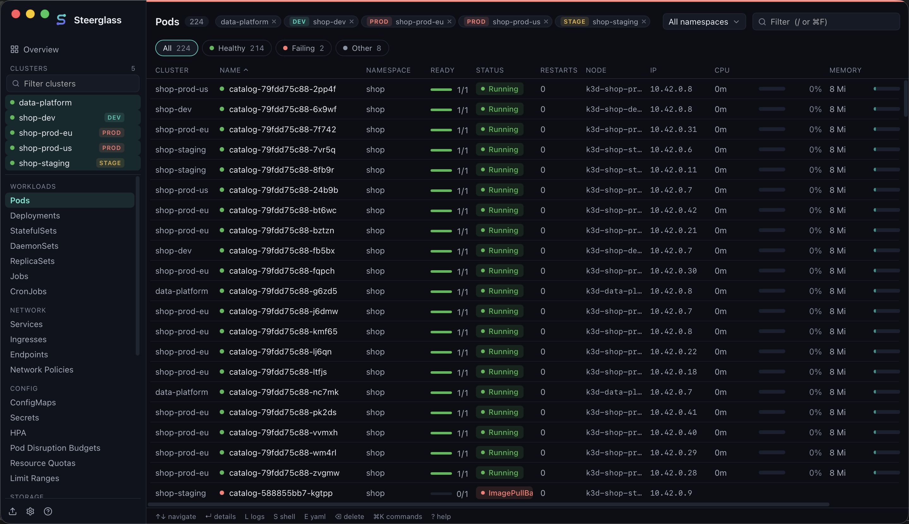
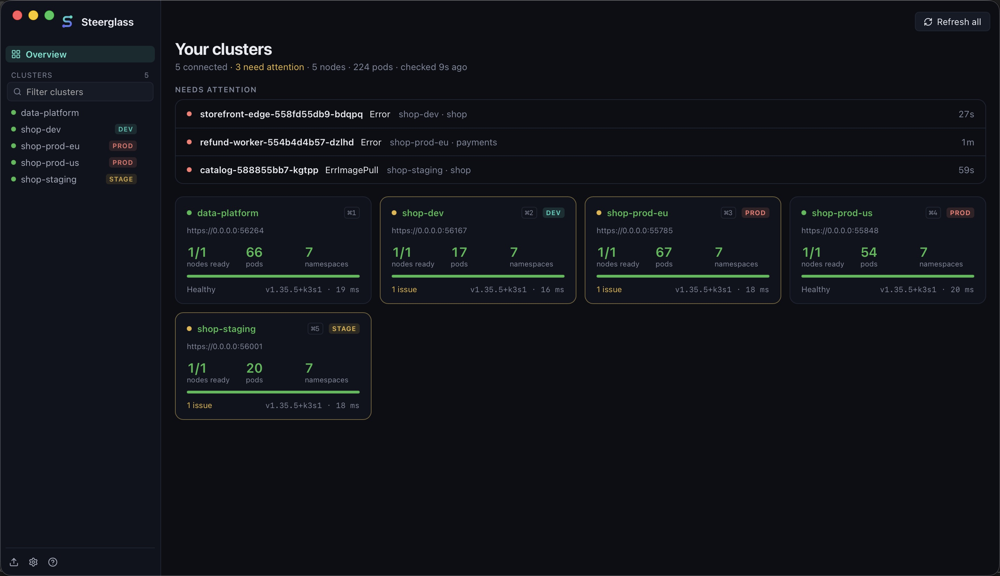

<p align="center"></p>

<h1 align="center">Steerglass</h1>

<p align="center">
  A fast, keyboard-first desktop app for operating <b>many Kubernetes clusters at once</b>.<br>
  <a href="https://steerglass.com">Website</a> · <a href="https://steerglass.com/install/">Download</a> · <a href="https://steerglass.com/changelog/">Changelog</a> · <a href="https://github.com/steerglass/steerglass/issues">Issues</a>
</p>

<p align="center">
  <a href="LICENSE"></a>
  
  
</p>

<p align="center"></p>

Steerglass is for people who work in many clusters every day: production in two regions, staging,
dev, a data platform. Pick several clusters and their pods, deployments or any other resource land
**side by side in one live table**, with a Cluster column. It is a native app (Rust core, ~10 MB),
it loads big clusters in about a second, and it marks production clearly so you don't change the
wrong cluster.

Free and open source under the Apache 2.0 license. No account, no telemetry: your kubeconfig and
everything in your clusters stay on your machine.

[▶ Watch the one-minute demo](https://steerglass.com/#demo)

## Install

| System | How |
| --- | --- |
| **macOS** 11+ | `brew install --cask davidebettio/tap/steerglass`, or the signed and notarized [`.dmg`](https://steerglass.com/install/#macos) (Apple Silicon and Intel) |
| **Windows** 10+ | [installer](https://steerglass.com/install/#windows) (`.exe` or `.msi`) |
| **Linux** | [apt and dnf repositories](https://steerglass.com/install/#linux), `.deb`, `.rpm` or AppImage, x86_64 and arm64 |

Every option, with checksums: [steerglass.com/install](https://steerglass.com/install/). Steerglass
updates itself, and every update is signed: the app refuses one it can't verify.

It finds your clusters on its own: it reads `$KUBECONFIG`, `~/.kube/config` and the other kubeconfig
files in `~/.kube`, like kubectl. Credential plugins (gke-gcloud-auth-plugin, aws, kubelogin…) work as
in your terminal, even when the app is started from the Finder or the Start menu.

## Features

**Many clusters at once**



- **Overview** of every cluster: health, version, nodes, pods, API latency, and a *Needs attention*
  list of failing pods, NotReady nodes and failed jobs.
- **Cross-cluster tables**: ⌘/Ctrl-click clusters in the sidebar to see the same resource of all of
  them in one live table.
- **Environments**: production, staging, development and local clusters get a color and a tag,
  detected from the context name or set by you.

**Fast and live**
- Resources are streamed with Kubernetes watches. Built-in kinds come as server-side tables (only the
  columns shown, up to 15× less data than full objects); updates are batched in Rust and rendered once
  per frame in a virtualized table, so tens of thousands of rows stay smooth.
- Every resource type: built-in kinds with kubectl-style columns, and every CRD discovered in the
  cluster, with its Ready/phase status.
- Filter with `/`: words match every column, and `status:bad` shows only failing or warning rows.

**Inspect and debug**
- **Logs**: follow, search, previous container, timestamps, ANSI colors.
- **Shell** into containers, **debug containers** for images without a shell (distroless, scratch),
  and **node shells**, like `kubectl debug`.
- **Port-forward** pods and services with one click; the local address shows right on the port.
- **CPU and memory**: usage next to requests and limits, node capacity, and per-pod history charts
  (up to 24 hours, kept by the app; only metrics-server is needed).
- **ConfigMaps you can read**: JSON, YAML, TOML, INI, nginx and shell files highlighted, `.env` files
  as a table, certificates decoded with their expiry, and *Used by*: the workloads that mount them.
- **Resource quotas** as usage bars, **limit ranges**, events.

**Change things safely**
- Edit YAML, apply manifests (server-side apply), scale, rollout restart, delete, cordon/uncordon,
  suspend/resume CronJobs.
- Production clusters ask before every change, with the cluster shown in red; deleting there means
  typing the object's name.

**Keyboard first**
- ⌘K command palette for resources, clusters, namespaces and actions; single-key shortcuts for the
  rest (see below). Light and dark themes.

How it compares with Lens, k9s and Headlamp: [steerglass.com/compare](https://steerglass.com/compare/).

## Keyboard shortcuts

| Key | Action |
| --- | --- |
| ⌘K / : | Command palette (resources, clusters, namespaces, actions) |
| / or ⌘F | Filter the table (`status:bad` shows only unhealthy rows) |
| ↑↓ / j k | Move selection, ↵ open details, Esc close |
| L / S / E | Logs / Shell / Edit YAML of the selected object |
| R / ⌫ / C | Rollout restart / Delete / Copy name |
| N | Pick a namespace (type to search) |
| ⌘1…9, ⌘0 | Jump to favorite cluster N, back to overview |
| ? | Help: every shortcut and tip |

On Windows and Linux, Ctrl takes the place of ⌘.

## Privacy and security

Steerglass talks directly from your computer to your Kubernetes API servers. Nothing about your
clusters is sent anywhere: the app has no accounts, no telemetry and no crash reporting, and it only
contacts steerglass.com to check for and download updates. How releases and updates are signed:
[steerglass.com/security](https://steerglass.com/security/). To report a vulnerability, see
[SECURITY.md](SECURITY.md).

## Development

Requirements: Rust (stable), Node 22+, pnpm; on Linux, the
[Tauri prerequisites](https://tauri.app/start/prerequisites/).

```sh
pnpm install
pnpm tauri dev                                          # the app, with hot reload
cargo test --manifest-path src-tauri/Cargo.toml --lib   # Rust tests
pnpm test                                               # frontend tests
```

Test against clusters you own (kind, k3d or minikube are perfect). `scripts/demo/up.sh` creates five
local k3d clusters with realistic workloads, and `scripts/demo/run-app.sh` opens the app on them only,
without touching your `~/.kube`. More in [CONTRIBUTING.md](CONTRIBUTING.md).

## Architecture

A Tauri 2 app: the Rust core talks to Kubernetes (kube-rs) and pushes rows to a React UI through
Tauri channels.

```
src-tauri/src
  kubeconfig.rs  merge kubeconfig files, fix PATH for exec auth plugins
  state.rs       per-context client cache, discovery cache, running streams
  commands.rs    request/response commands (summary, discovery, YAML, scale, delete…)
  table.rs       list + watch of server-side tables (only the printed columns)
  streams.rs     watch / logs / exec / port-forward pushed through Tauri channels
  rows.rs        object → compact table row (kubectl column logic, health)
  metrics.rs     CPU and memory from metrics-server, with history
  debug.rs       debug containers and node shells
  refs.rs        "Used by" for ConfigMaps and Secrets
  console.rs     Windows: a hidden console for credential plugins
  sandbox.rs     macOS App Sandbox helpers (real home, security-scoped bookmarks)
src
  useWatch.ts    merges live rows from N clusters, frame-coalesced renders
  store.ts       app state (Zustand)
  components/    Sidebar, Overview, ResourceTable, DetailPanel, Logs, Terminal…
website/         steerglass.com (static pages)
```

The UI never receives full objects for tables: Rust computes the visible columns, which keeps IPC
and memory small. Full objects are fetched on demand for the detail panel.

Releases, signing and the optional Mac App Store build: [docs/DISTRIBUTION.md](docs/DISTRIBUTION.md).

## Contributing

Bug reports, ideas and pull requests are welcome: see [CONTRIBUTING.md](CONTRIBUTING.md). In the app,
Help → Send feedback opens a new issue with your version and system filled in.

Steerglass is young (version 0.x) and moves fast: if something doesn't work with your clusters, an
issue helps a lot.

## Sponsors

Steerglass is free and open source, and sponsors help keep it that way. Companies get their logo and a
link here and on [steerglass.com](https://steerglass.com): see [steerglass.com/sponsor](https://steerglass.com/sponsor/).

## License

Steerglass is licensed under the [Apache License 2.0](LICENSE).

"Steerglass" and the Steerglass logo are trademarks of Davide Bettio. The license covers the code, not
the name or the logo: if you distribute a modified version, please give it a different name and icon.
Kubernetes is a registered trademark of The Linux Foundation.
